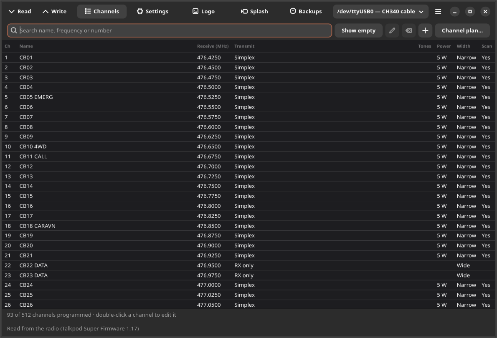
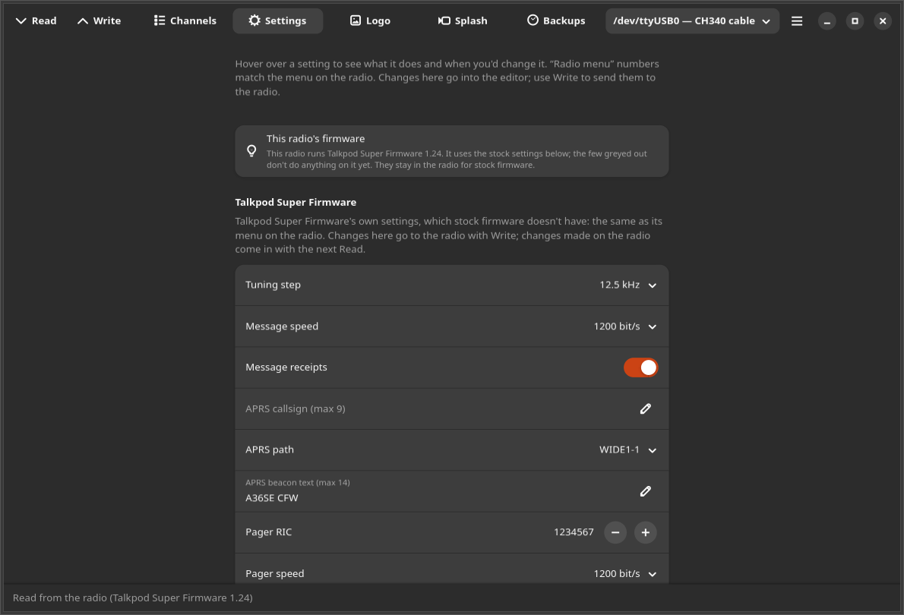
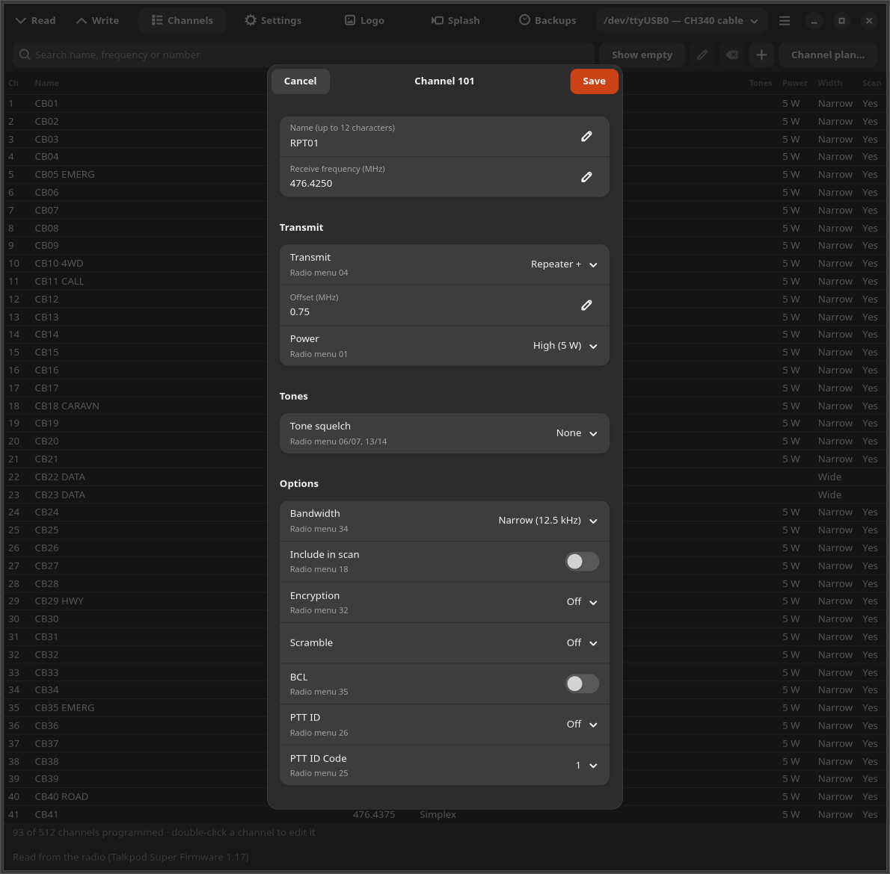
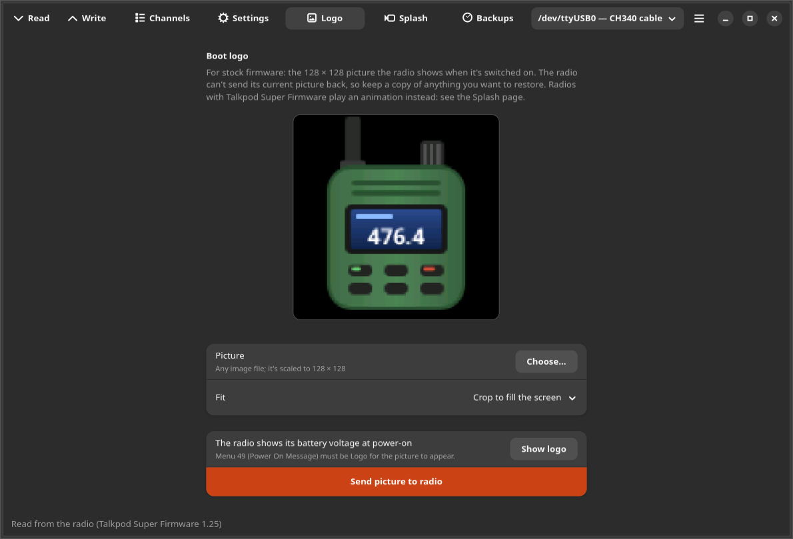
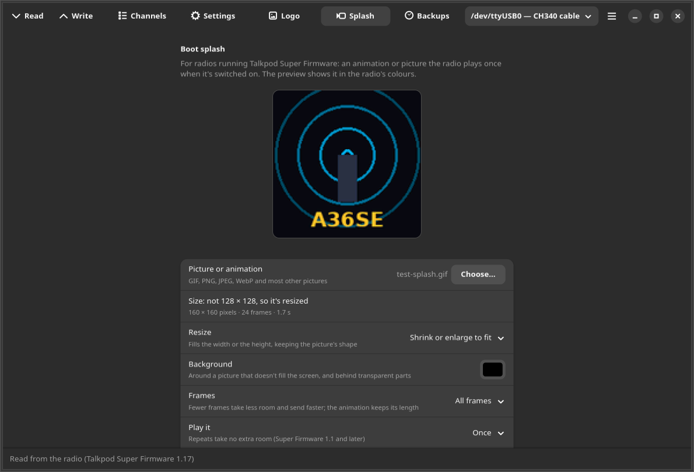
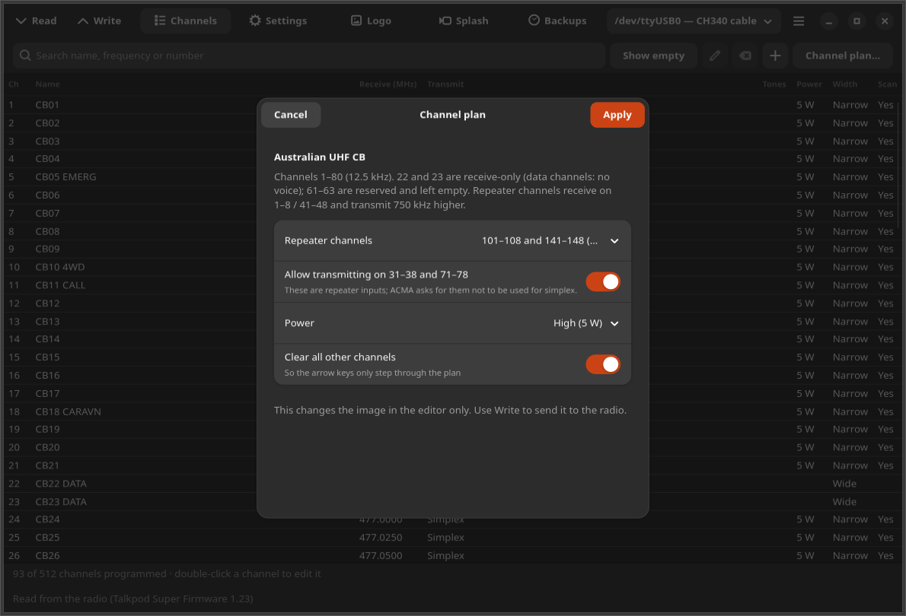
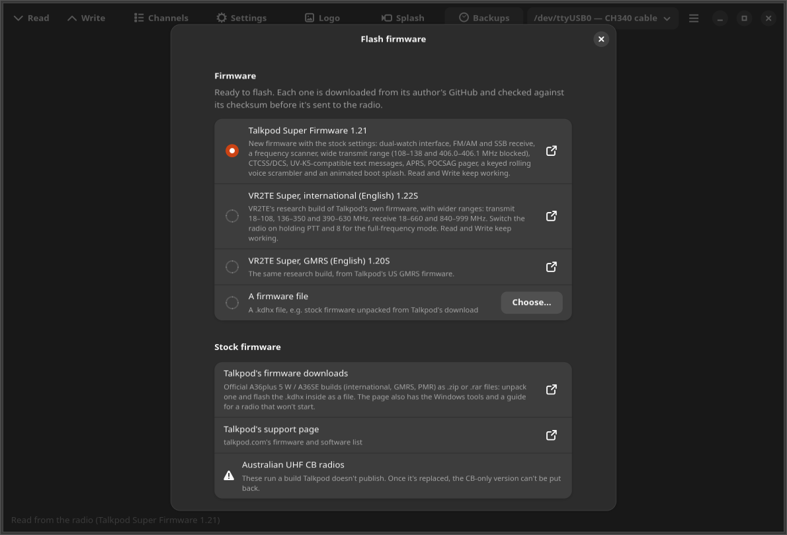
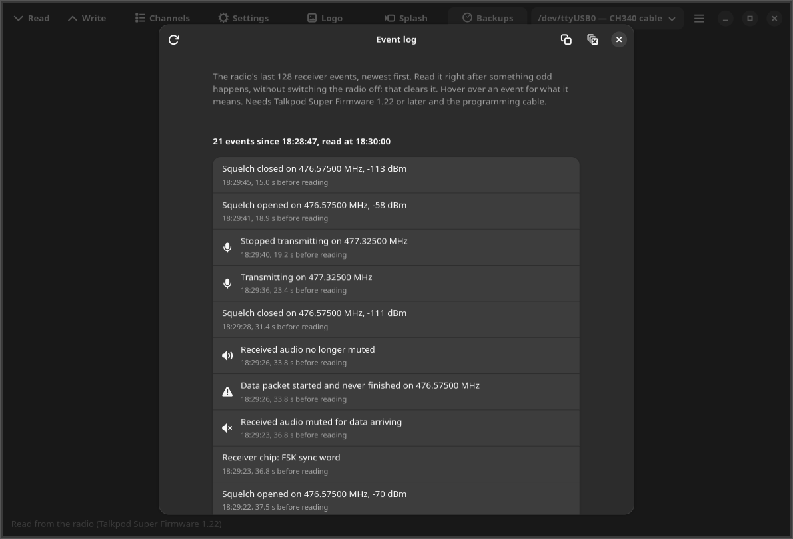
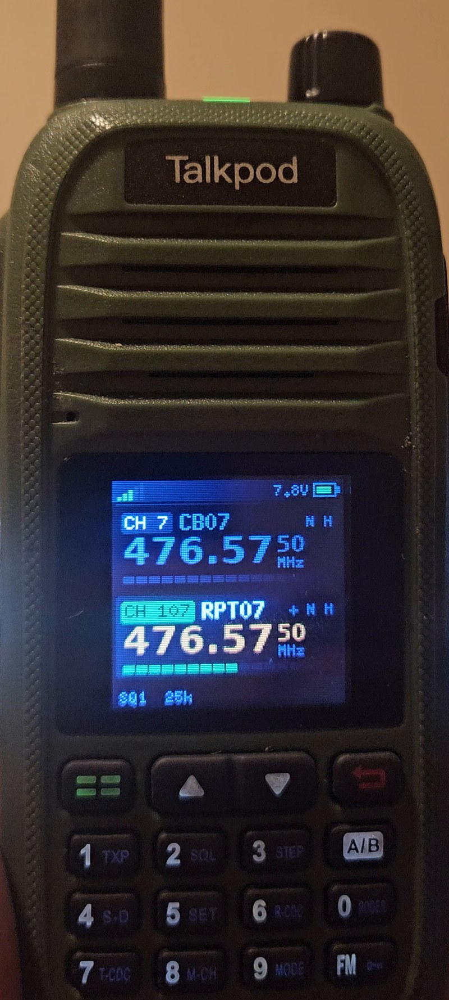

# Talkpod Manager

A desktop app for Ubuntu (GTK4 / libadwaita) to program, configure and back up **Talkpod A36SE**
and **A36plus** handheld radios over the K-plug programming cable.



## What it does

- **Read and write the radio**: all 512 channels and every menu setting. Every write first saves a
  backup of what's on the radio, then reads the radio back and checks it matches byte for byte.
- **Channel editor**: name, frequencies, repeater offset or split, CTCSS/DCS, power, bandwidth, scan,
  busy lock, PTT-ID, scrambler. Search and filter the list.
- **Radio settings**: the radio's menu items (squelch, time-out timer, side keys, VOX, backlight,
  scan resume, power-on message, DTMF/ANI codes, custom channel names, ...). Hover over any setting
  for a plain-language explanation and when you'd change it; the radio's own menu number is shown
  under each one. The channel editor's fields have the same help.
- **Channel plans**: one click for the Australian 80-channel UHF CB plan, with repeater (duplex)
  copies of channels 1–8 and 41–48 at 101–108 / 141–148 (or 401–448), and everything else cleared so
  the radio's arrow keys only step through the plan.
- **Boot logo** (stock firmware): send any picture as the 128 × 128 start-up logo, with a preview
  in the radio's 16-bit colours.
- **Boot splash** (Talkpod Super Firmware): send an animated GIF (or APNG, WebP, or a still picture)
  that the radio plays once when it's switched on. Pictures that aren't 128 × 128 are resized the
  way you choose (shrink to fit, shrink or enlarge to fit, stretch, crop), with an animated preview
  in the radio's colours and how much of the radio's 500 KB it takes.
- **Firmware**: flash firmware from the app (main menu → **Flash firmware…**). Ready to flash:
  [Talkpod Super Firmware](https://github.com/ssjrocks/talkpod-super-firmware) and VR2TE's "Super"
  builds of Talkpod's firmware, each downloaded from its author's GitHub and checked before it's
  sent. Any `.kdhx` file works too, and there are links to Talkpod's own firmware downloads.
- **Event log** (Talkpod Super Firmware 1.22+): reads the radio's log of its last 128 receiver events
  (squelch, carriers, what muted the audio and why, data packets, transmissions), keeps every reading,
  and explains each line on hover. For when the radio does something odd.
- **Backups**: automatic ones before and after every write, plus manual saves, in
  `~/Documents/Talkpod Manager/Backups`. Images are CHIRP `.img` files, so CHIRP opens them too.
- **CSV import/export** in CHIRP's CSV format (works with CHIRP and RepeaterBook exports).

| Settings, with hover help | Channel editor | Boot logo | Boot splash | Channel plan | Flash firmware | Event log |
|---|---|---|---|---|---|---|
|  |  |  |  |  |  |  |

## Supported radios



Talkpod A36SE (5 W; US GMRS, Australian UHF CB and international versions) and A36plus 5 W / 8 W
(A36plus MAX), with the firmware versions [CHIRP](https://chirpmyradio.com) supports (tested on an
Australian A36SE with firmware 1.26). The radio's firmware decides which frequencies it will
transmit on. Read and Write work with Talkpod's firmware, VR2TE's builds of it and Talkpod Super
Firmware 1.1 and later. All of them keep channels in the same layout, so images move between them.
The app shows which firmware it read and greys out what that firmware doesn't use (the data stays):
- Super Firmware 1.14 and later use the stock settings, apart from the few greyed out. Before that it
  ignored them, along with channel encryption (used from 1.16) and PTT-ID (from 1.14);
- it keeps some settings of its own as well. From 1.13 they're on the Settings page (step, dual watch,
  backlight, messages, APRS, pager, scramble key and so on), and Read and Write carry them like the
  channels.

The radio protocol and memory layout come from CHIRP's `mml_jc8810` driver, which this app uses as
a library. The boot-logo protocol was worked out from Talkpod's Windows "Import Picture" tool
(see [talkpod_manager/logo.py](talkpod_manager/logo.py)).

## Install

Ubuntu 24.04 or newer (needs GTK 4 and libadwaita 1.5+):

```bash
curl -fsSL https://raw.githubusercontent.com/ssjrocks/talkpod-manager/main/scripts/install.sh | bash
```

or from a checkout: `scripts/install.sh`. It installs missing GTK bindings with apt, puts the app in
a Python venv under `~/.local/share/talkpod-manager`, and adds it to the app grid.
`scripts/install.sh --uninstall` removes it (your backups stay).

To use the cable your user must be in the `dialout` group:
`sudo usermod -aG dialout $USER`, then log out and back in.

## Using it

1. Plug the programming cable into the PC and push the K-plug firmly into the radio's side jack.
2. Switch the radio on and press **Read**.
3. Edit channels or settings, or apply a channel plan, then press **Write**.

Changes stay in the editor until you Write. The bottom bar says when there are unwritten changes.

The boot logo is separate from Write: choose a picture on the **Logo** page and press
**Send picture to radio**. The radio can't send its current logo back, so the old one can't be
restored afterwards. The picture only shows if menu 49 (Power On Message) is set to Logo; the page
offers to change that.

### Boot splash (Talkpod Super Firmware)

Radios running Talkpod Super Firmware 1.0 or later play an animation at power-on instead of a still
logo. On the **Splash** page, choose a GIF (or APNG, WebP, PNG, JPEG...) and press **Send to
radio**. The radio must be switched on with the cable in; it doesn't need to be read first.

- The screen is 128 × 128. Other sizes are resized as chosen under **Resize**:
  - **Shrink or enlarge to fit** keeps the shape;
  - **Shrink to fit** only makes big pictures smaller;
  - **Stretch to fill** fills the screen and may change the shape;
  - **Crop to fill** fills the screen and cuts off the edges.
- **Background** fills the bars and transparent parts.
- A still picture is shown for the time you choose.
- **Frames** can skip every 2nd or 3rd frame of a big animation, keeping its length.
- **Play it** repeats an animation 2–10 times without taking more room (Super Firmware 1.1+; for 1.0
  the repeats are written out). **Hold the last frame** keeps its end on screen longer.
- Limits:
  - up to 15 s of animation (longer ones are cut) and 500 KB;
  - each frame up to 256 colours;
  - frames of at least 20 ms.

  Only what changes between frames is stored. The page shows the size, the room it takes and how
  long sending will take: about a minute per 100 KB, everything read back to check it.
- **Play the radio's splash now** shows what's on the radio; **Remove** takes it off (the radio
  then starts straight to its main screen).

The splash format and the firmware's serial commands are described in
[talkpod_manager/splash.py](talkpod_manager/splash.py).

### Event log (Talkpod Super Firmware 1.22+)

The radio keeps its last 128 receiver events in memory. After it does something odd (no sound with
a signal there, a channel that stays quiet), plug in the cable **without switching the radio off**,
open **Event log…** from the main menu and press the read button. Switching the radio off clears its
log.

Every reading is kept (in `~/.local/state/talkpod-manager/event-logs.json`) and shown in one text
field, oldest first: a header with when it was read, then each event with the date and time it
happened, in this computer's time zone. Hover over a line for what it means. The buttons copy all
of it as text (to send with a problem report), clear the radio's log, and delete the saved ones.

### Cable trouble

- The cables Talkpod ships use a CH340 or Prolific PL2303 USB chip; Linux drives both without
  extra software. The app lists the cable by chip name in the header.
- "The radio didn't answer": the plug isn't fully in (it needs a firm push through the rubber
  cover), the radio is off, or the volume is at zero.

## Firmware

**Flash firmware…** in the main menu flashes over the programming cable, the way Talkpod's Windows
"KDH Bootloader" tool does it (no Windows needed). Choose one of these ready-to-flash builds:

| Build | From | What it is |
|---|---|---|
| **Talkpod Super Firmware** (newest release; 1.23 comes with the app) | [ssjrocks/talkpod-super-firmware](https://github.com/ssjrocks/talkpod-super-firmware) | New firmware written from scratch, with the stock settings: dual-watch interface, SSB receive, frequency scanner, wide transmit range with aviation and distress-beacon bands blocked, UV-K5-compatible messages, APRS, POCSAG, boot animation |
| **VR2TE Super 1.22S** (international) and **1.20S** (GMRS) | [VR2TE/Talkpod-A36plus-Firmware](https://github.com/VR2TE/Talkpod-A36plus-Firmware/tree/main/A36plus) | Talkpod's own firmware with wider ranges: TX 18–108, 136–350, 390–630 MHz; RX 18–660, 840–999 MHz (switch on holding PTT and 8) |

No third-party firmware is copied into this app.
- **Talkpod Super Firmware:** the dialog downloads the newest release from GitHub and checks it
  against the SHA-256 GitHub publishes with it. A copy of 1.23 comes with the app for use offline.
- **VR2TE's builds:** fetched from a fixed commit of their repository, and must match checksums
  pinned in the app. A changed file is refused.
- **Your own file:** "A firmware file" takes any `.kdhx`.

**Stock firmware** comes from Talkpod: [talkpodonline.com → Firmware / Software](https://talkpodonline.com/pages/firmware-software)
(also linked from [talkpod.com](https://talkpod.com/pages/firmware_driver)). The A36plus 5 W / A36SE
builds are `.zip` / `.rar` archives: unpack one and choose the `.kdhx` inside as "A firmware file".
The dialog has these links.

The same flasher runs from the command line:

```bash
talkpod-firmware info  FIRMWARE.kdhx    # check a file without touching the radio
talkpod-firmware flash FIRMWARE.kdhx    # identify the radio, confirm, flash
```

It restarts the radio into its bootloader by itself. If an update is interrupted, switch the radio
on while holding the side keys (white screen) and flash again with "The radio shows the white
bootloader screen" turned on (`--manual` on the command line); the bootloader itself is never
overwritten. It refuses files that aren't A36plus firmware, and 8 W / MAX firmware
on a 5 W radio. Tested on an A36SE (official 1.26 to VR2TE's 1.22S): channels and settings survived
the firmware change, but save a backup first anyway.

Before flashing anything:

- **Firmware can't be read back** from the radio, so there's no backup of what you have now.
- **Region builds:** Talkpod publishes international/GMRS/PMR builds only. An Australian (UHF CB)
  A36SE runs an unpublished build; once replaced, its CB-only lock can't be restored.
- **Third-party builds** such as [VR2TE's "Super" firmware](https://github.com/VR2TE/Talkpod-A36plus-Firmware)
  (wider transmit/receive ranges) are untested research builds. Their author warns that
  transmitting below 108 MHz for more than 3 seconds destroys the power amplifier.
- Transmitting outside the bands your radio is approved for, or you're licensed for, is illegal.

## Updates and problem reports

- **Updates**: the app checks this repository's latest release at most every 12 hours and offers to
  install it. The download must come from github.com and match the SHA-256 published with the
  release.
- **Problem reports**: crashes, unexpected errors and the **Report a problem** menu item send a
  report to the developer's server (`ssjrocks.com`). A report contains: the app version, the error
  and its stack trace, the app's own log file (radio operations, no channel data), the PC's
  manufacturer and model name, the OS/kernel/Python versions, a random install ID, and for "Report a
  problem" your note plus the radio model, the cable's port name and the number of programmed
  channels. It doesn't contain channel lists, frequencies, files or personal data.

## Development

```bash
python3 -m venv --system-site-packages .venv
.venv/bin/pip install -e . pytest
.venv/bin/python -m pytest              # no radio needed (uses a saved image and a simulated radio)
.venv/bin/python -m talkpod_manager     # run from the checkout
GDK_BACKEND=x11 xvfb-run -a tools/screenshot.py tests/data/a36se-fw126-uhf-cb.img /tmp/shots \
    talkpod_manager/data/icons/hicolor/scalable/apps/io.github.ssjrocks.TalkpodManager.svg ANIMATION.gif
```

Releases: bump `__version__` in `talkpod_manager/__init__.py`, commit, then
`scripts/release.sh NOTES.md`.

## Licence

GPL-3.0-or-later (it builds on CHIRP, which is GPLv3). Not affiliated with Talkpod.
