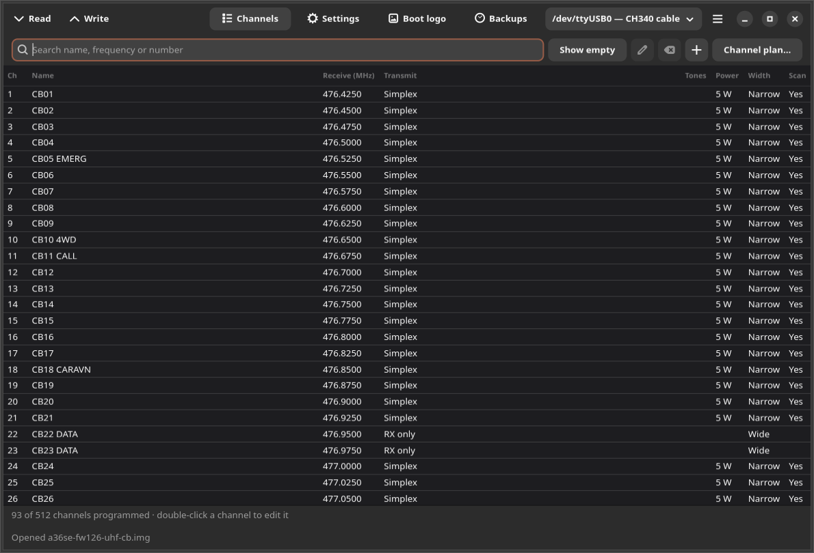
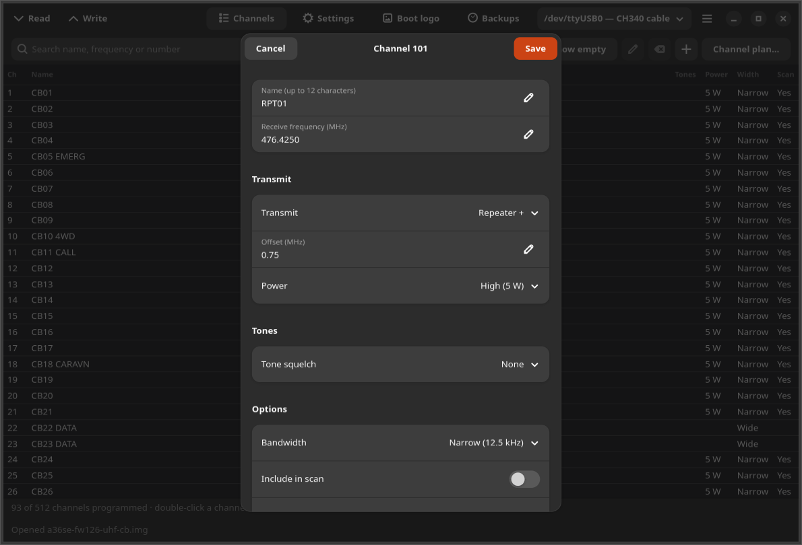
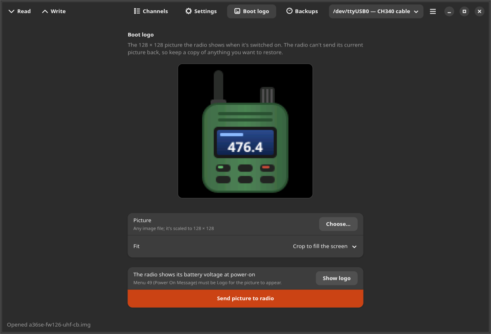
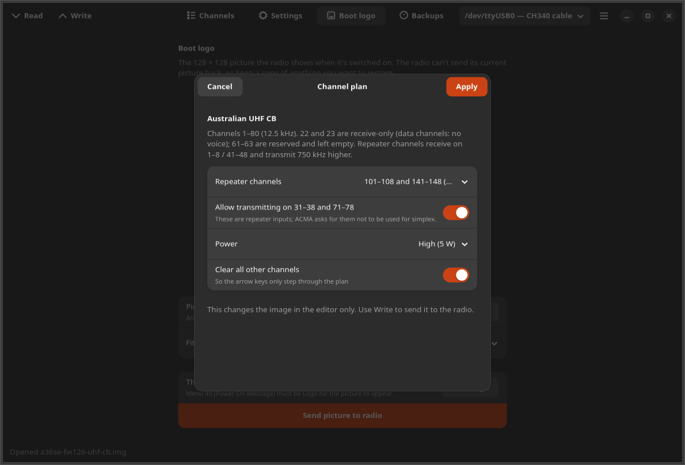

# Talkpod Manager

A desktop app for Ubuntu (GTK4 / libadwaita) to program, configure and back up **Talkpod A36SE**
and **A36plus** handheld radios over the K-plug programming cable.



## What it does

- **Read and write the radio**: all 512 channels and every menu setting. Every write first saves a
  backup of what's on the radio, then reads the radio back and checks it matches byte for byte.
- **Channel editor**: name, frequencies, repeater offset or split, CTCSS/DCS, power, bandwidth, scan,
  busy lock, PTT-ID, scrambler. Search and filter the list.
- **Radio settings**: the radio's menu items (squelch, time-out timer, side keys, VOX, backlight,
  scan resume, power-on message, DTMF/ANI codes, custom channel names, ...).
- **Channel plans**: one click for the Australian 80-channel UHF CB plan, with repeater (duplex)
  copies of channels 1–8 and 41–48 at 101–108 / 141–148 (or 401–448), and everything else cleared so
  the radio's arrow keys only step through the plan.
- **Boot logo**: send any picture as the 128 × 128 start-up logo, with a preview in the radio's
  16-bit colours.
- **Backups**: automatic ones before and after every write, plus manual saves, in
  `~/Documents/Talkpod Manager/Backups`. Images are CHIRP `.img` files, so CHIRP opens them too.
- **CSV import/export** in CHIRP's CSV format (works with CHIRP and RepeaterBook exports).

| Channel editor | Boot logo | Channel plan |
|---|---|---|
|  |  |  |

## Supported radios

Talkpod A36SE (5 W; US GMRS, Australian UHF CB and international versions) and A36plus 5 W / 8 W
(A36plus MAX), with the firmware versions [CHIRP](https://chirpmyradio.com) supports (tested on an
Australian A36SE with firmware 1.26). The radio's firmware decides which frequencies it will
transmit on; this app doesn't change that.

The radio protocol and memory layout come from CHIRP's `mml_jc8810` driver, which this app uses as
a library. The boot-logo protocol was worked out from Talkpod's Windows "Import Picture" tool
(see [talkpod_manager/logo.py](talkpod_manager/logo.py)).

## Install

Ubuntu 24.04 or newer (needs GTK 4 and libadwaita 1.5+):

```bash
curl -fsSL https://raw.githubusercontent.com/ssjrocks/talkpod-manager/main/scripts/install.sh | bash
```

or from a checkout: `scripts/install.sh`. It installs missing GTK bindings with apt, puts the app in
a Python venv under `~/.local/share/talkpod-manager`, and adds it to the app grid.
`scripts/install.sh --uninstall` removes it (your backups stay).

To use the cable your user must be in the `dialout` group:
`sudo usermod -aG dialout $USER`, then log out and back in.

## Using it

1. Plug the programming cable into the PC and push the K-plug firmly into the radio's side jack.
2. Switch the radio on and press **Read**.
3. Edit channels or settings, or apply a channel plan, then press **Write**.

Changes stay in the editor until you Write. The bottom bar says when there are unwritten changes.

The boot logo is separate from Write: choose a picture on the **Boot logo** page and press
**Send picture to radio**. The radio can't send its current logo back, so the old one can't be
restored afterwards. The picture only shows if menu 49 (Power On Message) is set to Logo; the page
offers to change that.

### Cable trouble

- The cables Talkpod ships use a CH340 or Prolific PL2303 USB chip; Linux drives both without
  extra software. The app lists the cable by chip name in the header.
- "The radio didn't answer": the plug isn't fully in (it needs a firm push through the rubber
  cover), the radio is off, or the volume is at zero.

## Updates and problem reports

- **Updates**: the app checks this repository's latest release at most every 12 hours and offers to
  install it. The download must come from github.com and match the SHA-256 published with the
  release.
- **Problem reports**: crashes, unexpected errors and the **Report a problem** menu item send a
  report to the developer's server (`ssjrocks.com`). A report contains: the app version, the error
  and its stack trace, the app's own log file (radio operations, no channel data), the PC's
  manufacturer and model name, the OS/kernel/Python versions, a random install ID, and for "Report a
  problem" your note plus the radio model, the cable's port name and the number of programmed
  channels. It doesn't contain channel lists, frequencies, files or personal data.

## Development

```bash
python3 -m venv --system-site-packages .venv
.venv/bin/pip install -e . pytest
.venv/bin/python -m pytest              # no radio needed (uses a saved image and a simulated radio)
.venv/bin/python -m talkpod_manager     # run from the checkout
GDK_BACKEND=x11 xvfb-run -a tools/screenshot.py tests/data/a36se-fw126-uhf-cb.img /tmp/shots
```

Releases: bump `__version__` in `talkpod_manager/__init__.py`, commit, then
`scripts/release.sh NOTES.md`.

## Licence

GPL-3.0-or-later (it builds on CHIRP, which is GPLv3). Not affiliated with Talkpod.
